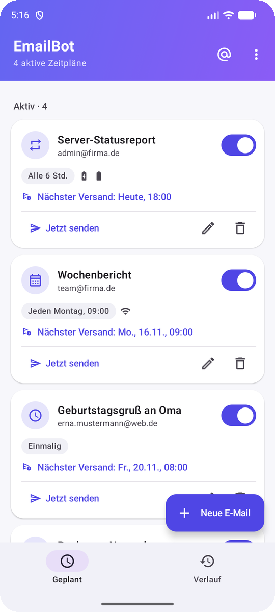
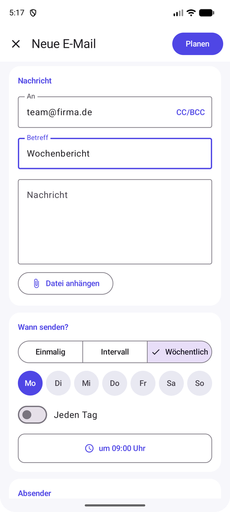
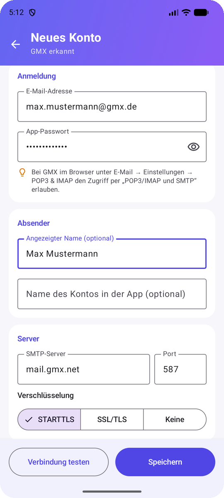
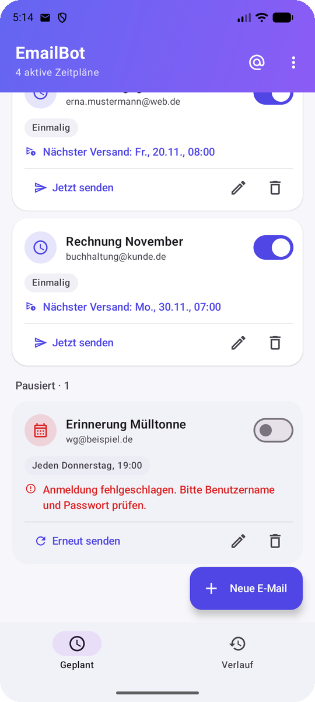
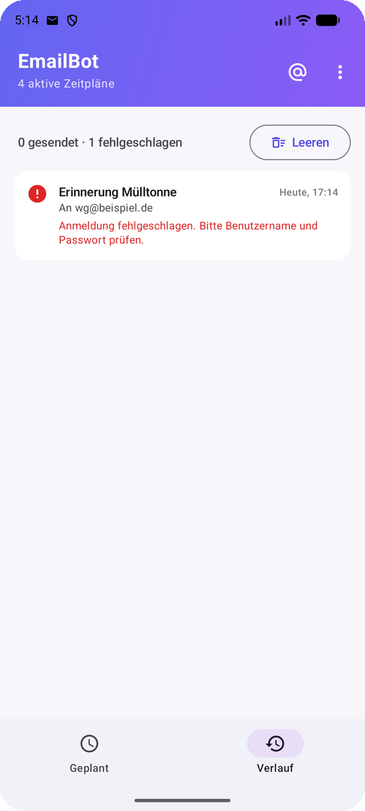
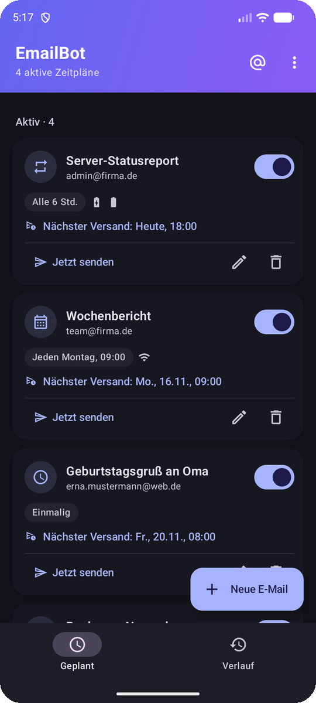
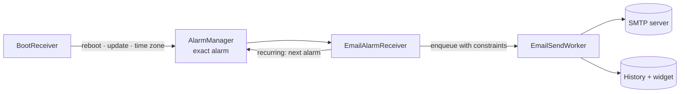

<div align="center">


# EmailBot

**Plan emails on your Android phone. They go out on time, even while it sleeps.**

[](#building)
[](https://kotlinlang.org)
[](LICENSE)

<br />

&nbsp;
&nbsp;


</div>

<br />

## Features

- **Three ways to schedule.** Once at a set time, every *n* minutes, or every week (or day) at a fixed time.
- **Always shows the next send.** Every email shows when it goes out next and when it last went out.
- **Several sender accounts.** Gmail, Outlook, GMX, WEB.DE, iCloud and Yahoo are set up automatically from the address. Any other SMTP server works too. Test the connection before you save.
- **Send conditions.** Only on Wi-Fi, only while charging, or only above a battery level. If a condition isn't met, the email waits for it.
- **Attachments.** Files are copied into the app, so they're still there at send time.
- **Clear errors.** Failed sends show a readable reason in the list, in the history and as a notification.
- **Widget, backup and dark mode.** A home screen widget shows the next send, JSON backup and restore moves your schedules to another phone, and the app follows the system theme.

> The app is currently in German only.

<div align="center">
&nbsp;
&nbsp;

</div>

## How it works



- **AlarmManager** wakes the phone at the scheduled time, even in Doze mode.
- **EmailAlarmReceiver** registers the *next* alarm right away for recurring emails, so a failed send never breaks the schedule. It then hands the send to WorkManager.
- **WorkManager** waits for the conditions (network, Wi-Fi, charging), sends, and retries network errors three times. Errors a retry can't fix, like a wrong password, fail right away.
- **BootReceiver** registers the alarms again after a reboot, an app update or a time zone change.
- A quiet **foreground service** runs only while something is scheduled. It keeps OEM battery savers (Samsung, Xiaomi …) from killing the app.

## Setting up an account

Enter your address and the server settings fill in by themselves. Most providers need one step in their web settings first:

| Provider | What to do first |
|---|---|
| Gmail | Turn on 2-step verification and create an [app password](https://myaccount.google.com/apppasswords). |
| Outlook / Hotmail | Create an app password in your Microsoft account's security settings. |
| GMX · WEB.DE | Allow *POP3/IMAP and SMTP* under *Settings → POP3 & IMAP*. |
| iCloud | Create an app-specific password at [appleid.apple.com](https://appleid.apple.com). |
| Yahoo | Create an app password in your account security settings. |

## Permissions

The app asks in a card at the top of the list, never in pop-ups on start:

| Permission | Why |
|---|---|
| Alarms & reminders | Send at the exact minute. Granted automatically on Android 13+. |
| Unrestricted battery use | Keeps Android from postponing sends while the phone is idle. |
| Notifications | Tells you when an email could not be sent. |

## Building

Requires Android Studio (recent stable) and JDK 17.

```bash
./gradlew assembleDebug        # build → app/build/outputs/apk/debug/
./gradlew installDebug         # install on a connected device
./gradlew testDebugUnitTest    # run the unit tests
```

<details>
<summary><b>Project structure</b></summary>

```
app/src/main/java/com/example/emailbot/
├── data/        tasks, accounts, send log (DataStore + kotlinx.serialization), password encryption
├── mail/        SMTP client and provider presets (JavaMail)
├── scheduler/   alarms, WorkManager worker, boot receiver, foreground service, notifications
├── ui/          Jetpack Compose screens (Material 3, Navigation 3)
├── widget/      home screen widget (Glance)
└── theme/       colors, theme, shared header
```

</details>

## Privacy & security

- SMTP passwords are encrypted with a key from the Android Keystore that never leaves the device.
- Accounts are excluded from Android's cloud backup and device transfer. The JSON export contains your schedules, never your accounts or passwords.
- Emails go straight from your phone to your mail provider. There is no server in between and no tracking.

## License

[MIT](LICENSE)
