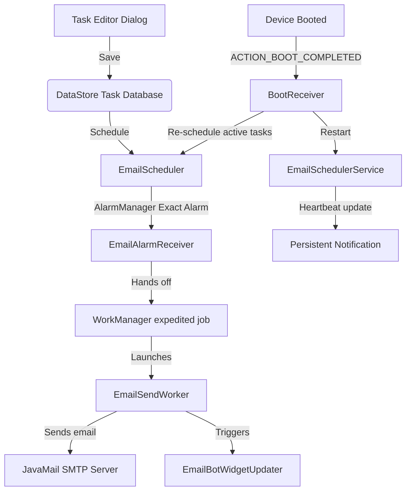

# EmailBot

An autonomous, battery-optimized Android background email scheduling engine. It sends automated emails according to exact schedules, even while the device is sleeping, in Doze mode, or after a system restart.

---

## Key Features

* **Scheduled Sending**  
  * **One-Time:** Send a single email at a specific date and time.
  * **Periodic:** Send repeatedly at fixed minute intervals.
  * **Cron-like Recurrence:** Send on specific days of the week (or daily) at a precise time (e.g., *every Monday at 09:00*).
* **Multi-Account SMTP Management**  
  * Add, edit, test, and delete multiple SMTP configurations.
  * Assign a specific sender account to each email schedule.
* **Smart Conditional Triggers**  
  * **Wi-Fi only:** Prevent using mobile data for attachments.
  * **Charging only:** Defer sending until the phone is plugged in to protect battery life.
  * **Battery threshold:** Block execution if the battery is below a user-defined percentage.
* **Attachments Support**  
  * Pick and copy any document, photo, or file to the app's secure internal sandbox to send as an attachment.
* **Tap-to-Test Connection**  
  * Verify SMTP host, authentication credentials, port, and SSL/TLS Handshakes directly in the settings before saving.
* **Jetpack Glance Widget**  
  * A modern, responsive home screen widget showing active schedule counts and the status of the last sent email.
* **JSON Backup & Restore**  
  * Export all active tasks as a JSON file via Android's Share Sheet. Import them back on any device with one tap.

---

## Architecture: 100% Background Autonomy

To guarantee scheduled emails are sent reliably on modern Android versions (with aggressive battery savers, Doze mode, and vendor-specific process management), EmailBot uses a multi-layered background architecture:



1. **`AlarmManager` (Exact Alarms):** Used to wake up the system at the exact millisecond of the scheduled run, bypassing standard Android sync grouping.
2. **`WorkManager` (Expedited Workers):** Once `AlarmManager` fires, it immediately hands execution over to an *expedited* `CoroutineWorker`. This gives the job immediate execution priority and system resources, even in Doze mode.
3. **`Foreground Service`:** A lightweight foreground service runs a silent heartbeat loop to keep the scheduler process prioritized, preventing aggressive OEM firmware (like Samsung, Xiaomi, or Huawei) from putting the app to sleep.
4. **`BootReceiver`:** Automatically restores all schedules from the database when the device restarts.

---

## Tech Stack & Dependencies

* **UI:** Jetpack Compose + Material 3
* **Navigation:** `androidx.navigation3` (Declarative Type-safe Navigation)
* **Background Processing:** WorkManager + AlarmManager
* **Database & Persistence:** Jetpack DataStore (Preferences + kotlinx.serialization)
* **SMTP Client:** JavaMail for Android (`com.sun.mail:android-mail`)
* **Home Screen Widget:** Jetpack Glance AppWidget

---

## SMTP Server Presets

When creating an account, the app automatically populates settings for known email providers. Refer to this setup guide if you want to configure them manually:

| Provider | Host | Port | Security Protocol | Required Action |
|---|---|---|---|---|
| **Gmail** | `smtp.gmail.com` | `587` | `STARTTLS` | Enable 2FA, generate and use an **App Password**. |
| **Outlook / Hotmail** | `smtp-mail.outlook.com` | `587` | `STARTTLS` | Generate and use an **App Password**. |
| **GMX** | `mail.gmx.net` | `587` | `STARTTLS` | Turn on **IMAP/SMTP access** in your GMX browser settings. |
| **Web.de** | `smtp.web.de` | `587` | `STARTTLS` | Turn on **IMAP/SMTP access** in your Web.de browser settings. |

---

## Required Permissions

For the app to work reliably in the background, you must grant the following permission requests when prompted inside the app:

* **Exakte Alarme erlauben (SCHEDULE_EXACT_ALARM):** Allows the system to wake up exactly at your scheduled time.
* **Akku-Optimierung umgehen (REQUEST_IGNORE_BATTERY_OPTIMIZATIONS):** Prevents Android from killing the background service or delaying workers when the device is left idle.
* **Benachrichtigungen erlauben (POST_NOTIFICATIONS):** Used to display the persistent background status notification and notify you when an email is sent.

---

## How to Build

1. Clone this repository.
2. Open the project in Android Studio (Jellyfish or newer recommended).
3. Build the project or run the gradle commands directly:

```bash
# Build Debug APK
./gradlew assembleDebug

# Install directly to your connected device
./gradlew installDebug
```

---

## License

This project is licensed under the MIT License - see the [LICENSE](LICENSE) file for details.
